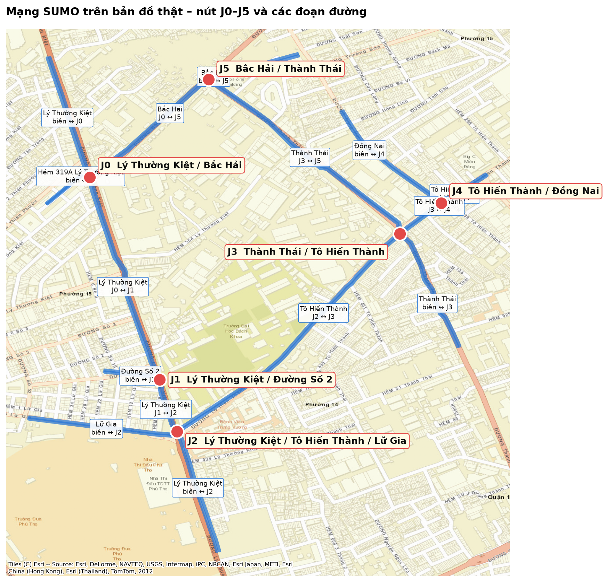

# VietTSC-Benchmark

A traffic-signal-control benchmark for Ho Chi Minh City built from **real city-camera data**.

Public HCMC traffic cameras publish one still image every 10–15 s at 512×288. This repository turns those
snapshots into **vehicles per hour per class** (motorcycle, car, truck, bus) and uses them as **SUMO demand** on a
6-junction network around Ly Thuong Kiet / To Hien Thanh / Thanh Thai (District 10). The result is a fixed set of
light / medium / heavy scenarios with **train / val / test splits, each generated with one fixed seed**, plus
fixed-time, MaxPressure and MPLight controllers.

```
 city-camera snapshots ──► YOLO11x ──► new-vehicle counting ──► × β(class, gap) ──► vehicles / hour / class
   (512×288, every 10–15 s)  (COCO, no   (Hungarian matching +      (fitted on 298 videos      per camera, per hour
                              fine-tune)  parked-cell mask)          with ground truth)
                                                                                 │
                                                       light / medium / heavy hours (results/flow/demand_settings.json)
                                                                                 ▼
  SUMO network (6 junctions) ◄── routeSampler: routes that reproduce the camera counts ◄── fixed seed per split
        │
        ▼
  run_tsc.py: fixed-time / MaxPressure / MPLight  →  train on train, select on val, report on test
```

---

## Contents

1. [Repository layout](#1-repository-layout)
2. [Installation](#2-installation)
3. [Quick start: run the benchmark](#3-quick-start-run-the-benchmark)
4. [Benchmark definition](#4-benchmark-definition)
5. [Baseline results](#5-baseline-results)
6. [Flow estimation: model, training, inference](#6-flow-estimation-model-training-inference)
7. [Rebuilding everything from scratch](#7-rebuilding-everything-from-scratch)
8. [Limitations](#8-limitations)

---

## 1. Repository layout

```
VietTSC-Benchmark/
├── models/yolo11x.pt                  detector weights (Git LFS, 115 MB, Ultralytics COCO release)
├── flow_estimation/                   camera snapshots -> vehicles/hour (README inside: full method)
│   ├── common.py                      classes, matching, parked-cell mask, metrics (the core algorithm)
│   ├── build_calibration_set.py       ground truth + 512x288 snapshots from tracked videos
│   ├── detect.py                      YOLO11x on any image list -> detection cache
│   ├── calibrate.py                   TRAINING: thresholds + beta(class, gap), 3-fold CV over cameras
│   ├── infer.py                       INFERENCE: real camera sessions -> per-frame, 10-min, hourly flow
│   ├── window.py                      flow of any clock window -> demand settings
│   ├── figures.py / visualize.py      report figures, matching / parked-vehicle illustrations
│   └── calibration/yolo11x_1280.json  the fitted calibration used everywhere (thresholds, beta, CV error)
├── data/
│   ├── calibration/                   ground-truth flow of 298 videos, snapshot list, camera folds
│   ├── detections/                    cached YOLO11x boxes (calibration set + real cameras), gzip jsonl
│   └── city_cam/                      raw camera sessions (NOT included, see data/README.md)
├── results/
│   ├── flow/                          estimated flow of the 4 real cameras + demand_settings.json
│   ├── figures/                       tables and charts
│   └── baselines/                     fixed-time and MaxPressure on the test split
├── build_demand.py                    builds sumo/scenarios/{train,val,test}/{light,medium,heavy}
├── sumo/
│   ├── map/hcmc.net.xml.gz            study network (6 junctions, built by build_network.py)
│   ├── config/                        junction agents, camera -> edge mapping, GUI settings
│   ├── bicycle/                       bicycle trips (not observed by cameras, kept from the original setup)
│   └── scenarios/                     THE BENCHMARK: 3 splits x 3 settings (+ stress/test-heavy)
├── run_tsc.py                         train / evaluate controllers
├── sim_sumo.py                        open a scenario in sumo-gui
├── tsc/                               SUMO environment, junction model, MPLight (FRAP), MaxPressure, fixed-time
├── build_network.py, build_trips.py   network construction and the original random-density demand
└── docs/                              MAP_CHANGES.md (network spec), TSC_ENVIRONMENT.md (agents, MPLight
                                       reproduction details), figures/
```

## 2. Installation

```bash
git lfs install && git clone https://github.com/KamonHuiz/VietTSC-Benchmark.git   # LFS fetches models/yolo11x.pt
cd VietTSC-Benchmark
python -m pip install -r requirements.txt
```

* **SUMO** ≥ 1.20 (tested 1.28.0). `pip install eclipse-sumo` works, or install SUMO and set `SUMO_HOME`
  (Windows: `install_deps.ps1`). `libsumo` makes training ~10× faster than TraCI.
* **GPU** only for running YOLO on new images. Everything else (calibration, inference from the cached
  detections, scenarios, controllers) runs on CPU.
* No LFS? `detect.py` falls back to `yolo11x.pt`, which Ultralytics downloads automatically
  (sha256 `7bc158aa95c0ebfdd87f70f01653c1131b93e92522dbe15c228bcd742e773a24`).

## 3. Quick start: run the benchmark

The scenarios are already generated; nothing has to be rebuilt.

```bash
# watch a scenario (opens sumo-gui); or open sumo/scenarios/test/heavy/osm.sumocfg directly
python sim_sumo.py -mode heavy --split test

# baselines on the test split
python run_tsc.py eval --algo fixedtime   --mode heavy
python run_tsc.py eval --algo maxpressure --mode heavy

# MPLight: trains on the train split, greedy test every round on the val split
python run_tsc.py train --algo mplight --mode heavy --rounds 100
# report the checkpoint that is best on val, evaluated on test
python run_tsc.py eval  --algo mplight --mode heavy --model runs/mplight_heavy_<time>/models/round_<k>.pt
```

`--split` overrides the default (`train` for `train`, `test` for `eval` and `sim_sumo.py`).

## 4. Benchmark definition

### 4.1 Network

Six signalised junctions around HCMC University of Technology (details: [docs/MAP_CHANGES.md](docs/MAP_CHANGES.md)):

| Junction | Streets | Agent |
|---|---|---|
| J0 | Ly Thuong Kiet / Bac Hai (+ Hem 319A) | yes, 3 phases |
| J1 | Ly Thuong Kiet / Duong So 2 | yes, 2 phases |
| J2 | Ly Thuong Kiet / To Hien Thanh / Lu Gia | yes, 2 phases |
| J3 | Thanh Thai / To Hien Thanh | yes, 2 phases |
| J4 | To Hien Thanh / Dong Nai | no (fixed time, edge of area) |
| J5 | Bac Hai / Thanh Thai | yes, 3 phases |



Motorcycles use the sublane model (lateral resolution 0.4 m). Signal timings are placeholders (30 s green + 3 s
yellow) until measured plans are available.

### 4.2 Where the demand comes from

Four city cameras are mapped to the road segment they watch. A camera count covers **both directions** and is
split 50/50 ([sumo/config/camera_segments.json](sumo/config/camera_segments.json)):

| Camera | SUMO segment |
|---|---|
| Ly Thuong Kiet – Bac Hai | Bac Hai J0 ↔ J5 |
| To Hien Thanh 2 | Ly Thuong Kiet J0 ↔ J2 (both J0–J1 and J1–J2) |
| To Hien Thanh 1 | To Hien Thanh J2 ↔ J3 |
| Thanh Thai – To Hien Thanh | Thanh Thai J5 ↔ J3 |

The three settings are three real hours, chosen so that totals step evenly
([results/flow/demand_settings.json](results/flow/demand_settings.json); mean of the 4 cameras, vehicles/hour,
both directions):

| Setting | Source hour | Motorcycle | Car | Truck | Bus | Total |
|---|---|---:|---:|---:|---:|---:|
| **light** | 12 Nov 2026, 05:30–06:30 | 5,241 | 756 | 150 | 66 | **6,212** |
| **medium** | 07 Nov 2026, 13:06–14:06 | 6,634 | 1,164 | 288 | 69 | **8,155** |
| **heavy** | 29 Oct 2026, 10:50–11:50 | 9,212 | 1,169 | 440 | 86 | **10,907** |

Each scenario uses the **per-camera** values of its hour, not only the mean.

### 4.3 Demand generation and the fixed seeds

`build_demand.py` ([sumo/README.md](sumo/README.md) explains it step by step with examples):

1. **Candidate routes.** Every fringe-to-fringe route per vehicle class: randomTrips with `--fringe-factor max`,
   routed by duarouter (shortest path, turn bans and vClass permissions respected). This gives 73 routes per class,
   computed once and deterministically.
2. **Targets.** On each observed edge: camera count ÷ 2 × scale, per class, for the hour [0, 3600) s.
3. **Sampling.** SUMO `routeSampler` draws routes at random until every observed edge reaches its target.
   Departures are uniform in [0, 3600) s. Vehicles enter and leave only at the 9 fringe edges.

| Split | Seed | Used for |
|---|---:|---|
| `train` | **1001** | training episodes |
| `val` | **2002** | model selection (greedy test during training) |
| `test` | **3003** | reported numbers |

All three splits carry the **same flow on every observed edge**. They differ in which routes are drawn and in
the departure times, so a controller cannot memorise the test vehicles. Regenerating with the same seed gives
byte-identical files.

**Scale 0.25.** At 100% of the camera flow the network saturates. Each segment carries only ~3,500–4,500 veh/h
in SUMO, against 8,000–13,000 in reality, because real motorcycles ride denser than the SUMO model. The benchmark
therefore uses **25% of the measured flow for every camera, class and setting**; vehicle sizes are unchanged.
0.25 is the largest scale at which heavy still flows: 0.25, 0.3, 0.35 and 0.4 were tested, and 0.3+ builds queues
at the entries. `python build_demand.py --scale 1.0 --tag full` builds the full-scale variant.

| Scenario vehicles (bicycles excluded) | light | medium | heavy |
|---|---:|---:|---:|
| train (1001) | 3,879 | 5,038 | 6,726 |
| val (2002) | 3,884 | 5,053 | 6,714 |
| test (3003) | 3,862 | 5,005 | 6,691 |

`sumo/scenarios/stress/test-heavy` keeps the team's original oversaturated random stress test (12× density).

### 4.4 Protocol

* Episode: 3,600 simulated seconds; SUMO driver seed 0 (`--seed` in `run_tsc.py`).
* Train on `train`, choose the checkpoint on `val`, report `test`.
* Metrics (from `tsc/env.py`): average travel time over all departed vehicles (vehicles still in the network
  count with their time so far), travel time of arrived vehicles, arrived / departed, average queue, teleports.

## 5. Baseline results

Test split, one episode, SUMO seed 0 ([results/baselines/](results/baselines/)):

| Setting | Controller | Avg travel time (s) | Arrived-only (s) | Arrived / departed | Avg queue (veh) | Teleports |
|---|---|---:|---:|---:|---:|---:|
| light | fixed-time | **196.6** | 200.5 | 3,703 / 3,884 | 34.8 | 12 |
| light | MaxPressure | 240.2 | 245.6 | 3,647 / 3,884 | 70.9 | 10 |
| medium | fixed-time | **335.0** | 283.3 | 4,367 / 5,048 | 165.5 | 32 |
| medium | MaxPressure | 346.8 | 315.3 | 4,148 / 4,696 | 170.1 | 26 |
| heavy | fixed-time | **374.7** | 289.7 | 5,568 / 6,719 | 268.2 | 33 |
| heavy | MaxPressure | 389.4 | 350.8 | 5,345 / 6,261 | 259.4 | 48 |

MaxPressure is currently worse than the placeholder fixed-time plan on all three settings. MPLight results are
not included yet; a 1-round smoke test of `train` (train split, val greedy test) runs end to end.

## 6. Flow estimation: model, training, inference

Full description with figures and a worked example: **[flow_estimation/README.md](flow_estimation/README.md)**.

**Model.** YOLO11x, Ultralytics COCO weights, **not fine-tuned**; 512×288 images upscaled to 1280 inside the
model. Classes: motorcycle, car, truck, bus (bicycle only takes part in matching). It was chosen over YOLO11s and
over 640 input by cross-validated error on 512×288 images:

| Detector (512×288 input) | Motorcycle | Car | Truck | Bus | Total |
|---|---:|---:|---:|---:|---:|
| **YOLO11x @1280 (used)** | **18.1** | **20.9** | **42.3** | **39.8** | **15.5** |
| YOLO11s @1280 motorcycles + YOLO11x others | 19.6 | 20.9 | 42.3 | 39.8 | 17.1 |
| YOLO11s @1280 all classes | 19.6 | 24.6 | 51.9 | 44.8 | 17.8 |
| YOLO11s @640 motorcycles + YOLO11x others | 23.0 | 20.9 | 42.3 | 39.8 | 19.0 |

*WAPE %, 10 s gaps, held-out cameras.*

**Training (calibration).** 298 videos from 98 HCMC cameras with tracked ground truth. Snapshots every 5 s are
degraded to 512×288 JPEG and subsampled at gaps of 5/10/15/20/30 s. For each snapshot the detector's boxes are
paired with the previous snapshot by Hungarian matching on footpoints; unmatched boxes are **new vehicles**.
Vehicles in a cell occupied in ≥60% of a 10-min block are parked and ignored. The conversion factor is

> **β(class, gap) = median over videos of true flow ÷ counted new vehicles**

and confidence thresholds are chosen on a grid (final: 0.35 motorcycle, 0.30 others). β used in inference:

| Gap | Motorcycle | Car | Truck | Bus |
|---|---:|---:|---:|---:|
| 10 s | 2.15 | 0.83 | 0.75 | 0.57 |
| 15 s | 3.07 | 1.19 | 1.07 | 0.78 |

**Accuracy.** 3-fold cross-validation by camera (thresholds and β fitted on 2/3 of the cameras, applied to the
unseen third), 10/15 s mixed gaps, ~10-min windows:

| | Motorcycle | Car | Truck | Bus | Total |
|---|---:|---:|---:|---:|---:|
| WAPE | 18.5% | 21.1% | 41.2% | 40.6% | **15.8%** |
| Bias | −2.8% | −1.5% | −17.5% | −10.4% | −3.0% |

**Inference.** For each real image: same detector and thresholds, new vehicles vs the previous image,
× β of the **real** gap (rounded to 5/10/15/20/30 s), pairs more than 35 s apart dropped as missing data, then
Σ flow ÷ covered seconds × 3600 per hour. Results for 3 sessions × 4 cameras: [results/flow/](results/flow/),
figures in [results/figures/](results/figures/).

## 7. Rebuilding everything from scratch

```bash
# (a) calibration set (needs the tracked videos, see data/README.md)
python -m flow_estimation.build_calibration_set --tracks <acts> --mapkf <map-keyframes> --keyframes <keyframes> --out data/calibration
python -m flow_estimation.detect --list data/calibration/frames.jsonl --root data/calibration/images \
       --out data/detections/calibration_yolo11x_1280.jsonl.gz

# (b) TRAINING: thresholds, beta, cross-validation (~10 s from the cached detections)
python -m flow_estimation.calibrate --calib data/calibration \
       --dets data/detections/calibration_yolo11x_1280.jsonl.gz --out flow_estimation/calibration/yolo11x_1280.json

# (c) INFERENCE on the real cameras. With the raw images: --root data/city_cam (YOLO runs if the cache is missing).
#     Without them, from the committed cache: add --index data/detections/city_cam_frames.jsonl
python -m flow_estimation.infer --index data/detections/city_cam_frames.jsonl \
       --sessions 2026-10-29_0850-1250 2026-11-07_1306-1706 2026-11-12_0530-0700 \
       --exclude Cam_To_Hien_Thanh_Su_Van_Hanh \
       --dets data/detections/city_cam_yolo11x_1280.jsonl.gz \
       --calibration flow_estimation/calibration/yolo11x_1280.json --out results/flow

# (d) demand settings = three real hours
python -m flow_estimation.window --perframe results/flow/perframe.json \
       --setting light  2026-11-12_0530-0700 05:30 06:30 \
       --setting medium 2026-11-07_1306-1706 13:06 14:06 \
       --setting heavy  2026-10-29_0850-1250 10:50 11:50 --out results/flow/demand_settings.json

# (e) the benchmark scenarios (fixed seeds) and the figures
python build_demand.py
python -m flow_estimation.figures
```

From the files in this repository, steps (b)–(e) reproduce the committed calibration, flow tables and
scenarios exactly; (a) and the image part of (c) need the raw data.

## 8. Limitations

* Ground truth comes from video tracking, not manual counts; ID switches can inflate it slightly.
* Trucks and buses have ~41% error and are under-counted by 10–18%.
* β was fitted on daytime video. Before ~06:00 detection misses vehicles in the dark, so the light hour
  (05:30–06:30) is likely an underestimate.
* Camera counts are all directions combined; turning ratios at junctions are not observed and come from the
  random route draw.
* Demand is flat within the hour, and the network carries only 25% of the measured flow
  (vehicle-model calibration is future work).
* One camera of the original five (To Hien Thanh – Su Van Hanh) is not used.
