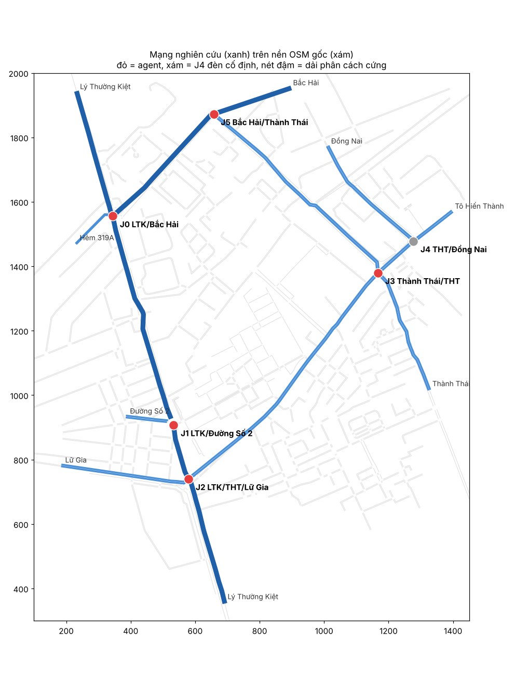

> **Note.** This is the README of the original 261-dacn environment (network, junction agents, MPLight
> reproduction). Its *Traffic modes* section describes the old random-density demand, which is now only used for
> `sumo/scenarios/stress/test-heavy`; the benchmark demand comes from `build_demand.py` (see the main README).

# 261-dacn

SUMO study network of 6 signalised junctions in Ho Chi Minh City (Lý Thường Kiệt, Bắc Hải,
Thành Thái, Tô Hiến Thành) at four traffic densities: **light**, **medium**, **heavy** and the
stress test **test-heavy**, plus MPLight / MaxPressure / fixed-time signal control.



## Quick start

```powershell
# Checks pip/requirements, then winget/SUMO. Asks before installing.
Set-ExecutionPolicy -Scope Process Bypass
.\install_deps.ps1

# Open a new terminal if PATH / SUMO_HOME just changed, then:
python sim_sumo.py -mode light              # sumo-gui
python sim_sumo.py -mode heavy --headless   # no GUI
```

Or install Python packages only: `python -m pip install -r requirements.txt`

## Project layout

```text
261-dacn/
  install_deps.ps1      # install Python deps + SUMO
  requirements.txt      # pip packages
  sim_sumo.py           # launch sumo-gui for a mode
  build_network.py      # build sumo/map/hcmc.net.xml.gz from the OSM import + team spec
  build_trips.py        # regenerate random trips by density
  run_tsc.py            # train / evaluate MPLight, MaxPressure, fixed-time
  tsc/
    config.py           # MPLight hyperparameters (official values) + SUMO settings
    junctions.py        # junction agents: movements, phases, counting zones
    env.py              # multi-junction SUMO environment (libsumo / TraCI)
    frap.py             # FRAP network (MPLight's Q-network)
    agents.py           # MPLight, MaxPressure, fixed-time
  docs/
    MAP_CHANGES.md      # what changed in the map and why (for review)
    network_overview.png
  sumo/
    map/
      hcmc.net.xml.gz   # study network (used by all scenarios)
      osm.net.xml.gz    # original OSM import, kept as geometry source only
      osm.poly.xml.gz   # buildings / land use for sumo-gui
      osm_bbox.osm.xml.gz
    config/             # SUMO / netconvert configs, junctions.json (agent list)
    scenarios/
      light/            # trips + osm.sumocfg (+ outputs after a run)
      medium/
      heavy/
      test-heavy/       # stress test (12x density, oversaturated)
```

## Study network

Built by `build_network.py` (see `docs/MAP_CHANGES.md` for the full specification):

| Junction | Streets | Type | Agent |
|---|---|---|---|
| J0 | Lý Thường Kiệt / Bắc Hải (+ Hẻm 319A, no signal) | 4 arms | yes, 3 phases |
| J1 | Lý Thường Kiệt / Đường Số 2 | 3 arms | yes, 2 phases |
| J2 | Lý Thường Kiệt / Tô Hiến Thành / Lữ Gia | 4 arms | yes, 2 phases |
| J3 | Thành Thái / Tô Hiến Thành | 4 arms | yes, 2 phases |
| J4 | Tô Hiến Thành / Đồng Nai | 3 arms | no: edge of area, fixed-time |
| J5 | Bắc Hải / Thành Thái | 3 arms | yes, 3 phases |

* Lý Thường Kiệt, Bắc Hải: hard median, 2 lanes × 3.5 m per direction.
  Other streets: painted centre line, 2 lanes × 3.0 m per direction. Hẻm 319A: 1 lane per direction.
* Alleys and small roads removed (Hẻm 319A kept as an arm of J0). No pedestrians. No U-turns.
* Turn rules and signal groups follow the team's description of each junction.
* Signal timings are **placeholders** (30 s green + 3 s yellow per phase) until real plans are measured.
* Motorcycles use the sublane model (`lateral-resolution` 0.4 m): they ride side by side and filter.

Rebuild after editing the spec: `python build_network.py`, then regenerate trips.

## Traffic modes

Trips are generated with `randomTrips.py` using insertion densities (vehicles / km / h) scaled
**1× / 2× / 3×** (unchanged from the original setup; pedestrians removed) and **12×** for the
stress test:

| Class       | Light | Medium | Heavy | Test-heavy |
|-------------|------:|-------:|------:|-----------:|
| bicycle     | 1     | 2      | 3     | 12         |
| bus         | 1     | 2      | 3     | 12         |
| motorcycle  | 24    | 48     | 72    | 288        |
| passenger   | 4     | 8      | 12    | 48         |
| truck       | 1     | 2      | 3     | 12         |
| **vehicles / hour** | **672** | **1 343** | **2 012** | **8 046** |

Densities are per km of road. The old OSM map had 38 km of road (mostly alleys), the study
network 11 km, so light/medium/heavy now carry fewer vehicles than before (old heavy: 4 292).
light/medium/heavy are uncongested to moderately loaded; **test-heavy is oversaturated on
purpose** to compare how algorithms cope with queues and spillback (12× chosen after trying
8× / 12× / 16×: 8× still clears, 16× gridlocks and takes ~5 min per episode).

```powershell
python build_trips.py -mode light     # also medium, heavy, test-heavy
```

`SUMO_HOME` must be set so the script can find `%SUMO_HOME%\tools\randomTrips.py`.

## Traffic-signal control: MPLight and MaxPressure

```powershell
python run_tsc.py junctions                                   # agents, movements, phases
python run_tsc.py eval  --algo fixedtime   --mode light       # placeholder fixed-time plans
python run_tsc.py eval  --algo maxpressure --mode light
python run_tsc.py train --algo mplight     --mode light --rounds 100
python run_tsc.py train --resume runs\mplight_light_<timestamp>          # continue a run
python run_tsc.py eval  --algo mplight     --mode heavy --model runs\...\models\round_99.pt --episodes 5
```

Each training run writes `runs/mplight_<mode>_<timestamp>/` with `config.json`, `progress.csv`
(one row per round), `models/round_<k>.pt` and `memory.pkl`. Add `--gui` to watch in sumo-gui,
`--traci` if libsumo is not available (same results, ~10x slower). Report the checkpoint with the
best greedy test result, as MPLight's learning curve fluctuates.

### Agents

One junction = one agent (`sumo/config/junctions.json`; set `"enabled": false` to leave a
junction on its fixed-time plan).

* **Movement** = (edge entering the junction, edge leaving it): MPLight's WL/WT/... movements.
  Free movements (no signal) are not part of the state.
* **Phase** = a green stage of the junction's signal program (`--phase-mode plan`, default),
  so the fixed-time baseline and the agents use the same phases.
* **Counting**: vehicles up to 200 m upstream/downstream; approaching vehicles are assigned to a
  movement by their route (CityFlow has one lane per movement, SUMO lanes are shared). This uses
  route information a camera would not have: fine for reproducing the baseline, but camera-based
  methods should restrict the state to camera-observable quantities.

### Reproduction of MPLight (Chen et al., AAAI 2020)

Values come from the official code (github.com/Chacha-Chen/MPLight: `config.py`
`DIC_TRANSFERDQNPRESSONE_AGENT_CONF`, `dic_traffic_env_conf`, `runexp.py`) and are kept in
`tsc/config.py` under the same names.

| Item | MPLight (official) | Here |
|---|---|---|
| Model | FRAP, one model shared by all intersections | same (`tsc/frap.py`, 1 369 parameters as the Keras model), padded/masked for junctions with 2-3 phases |
| State | current phase (per-movement bit) + movement pressure | same |
| Reward | -0.25 × \|Σ waiting vehicles in − Σ waiting out\|, mean over 10 s | same (waiting = speed < 0.1 m/s) |
| Action | choose a phase every 10 s; 5 s yellow on change, no all-red | same |
| DQN | Adam lr 1e-3, γ 0.8, reward / 20, target net = model from 5 rounds earlier | same |
| Memory / update | 10 000 per intersection; sample 1 000; ≤100 epochs, batch 20, val split 0.3, early stop 10 | same |
| Exploration | ε = max(0.8·0.95^round, 0.2), one draw per step for all intersections | same |
| Rounds | 100-700 depending on dataset, 3 600 s episodes, greedy test each round | 100 by default (`--rounds`) |

MaxPressure uses the same 10 s decisions and 5 s yellow: each interval it picks the phase with the
largest sum of movement pressures and keeps the current phase on ties.

### Baseline check (seed 0, one 3 600 s episode)

| Mode | Fixed-time ATT | MaxPressure ATT | Teleports (FT / MP) |
|---|---:|---:|---:|
| light | 182.7 s | 184.6 s | 0 / 1 |
| medium | 181.6 s | 193.0 s | 1 / 4 |
| heavy | 184.5 s | 201.5 s | 2 / 4 |
| test-heavy | 454.9 s | 403.3 s | 55 / 48 |

ATT is computed as in CityFlow (vehicles still in the network count until the end). In
light/medium/heavy the network is not congested, so ATT is mostly free-flow travel time and
MaxPressure loses a little to the frequent 5 s yellows. In test-heavy, adaptive control matters:
MaxPressure beats fixed-time. A 12-round MPLight smoke test on heavy reached 176.5 s.

Run time per round (train + greedy test): ~10 s light, ~20 s medium/heavy, ~4-5 min test-heavy.
For test-heavy use `--test-every 5` to save time.

## Install details

`install_deps.ps1` flow:

1. Check Python / pip / `requirements.txt` — if packages are missing, ask to run `pip install -r requirements.txt`
2. Check `winget`
3. Check Eclipse SUMO — if missing, ask to install with winget
4. Set `SUMO_HOME` and add `%SUMO_HOME%\bin` to user `PATH`

Manual SUMO install (if you skip the script):

1. Install from https://eclipse.dev/sumo/ or `winget install EclipseFoundation.SUMO`
2. Set `SUMO_HOME` to the install directory (folder that contains `bin\sumo-gui.exe`)
3. Add `%SUMO_HOME%\bin` to `PATH`
4. Restart the terminal

## Notes

- Extra SUMO arguments can be forwarded after `--`, for example:

```powershell
python sim_sumo.py -mode light -- --delay 50
```
