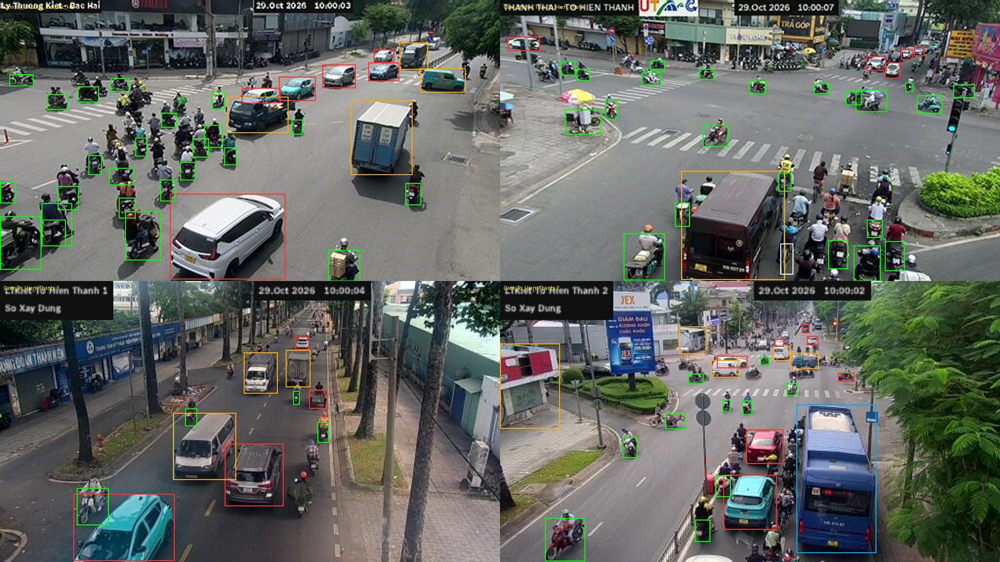
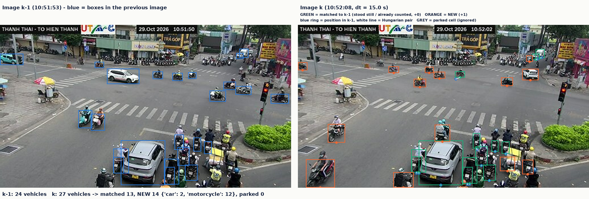
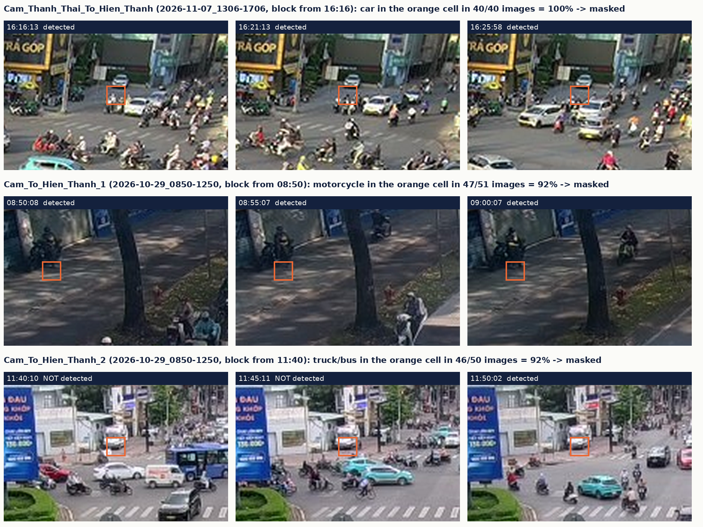
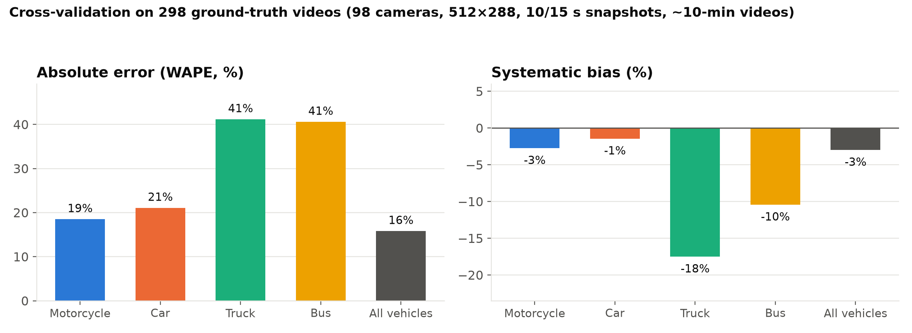

# Flow estimation: vehicles / hour per class from city-camera snapshots

The city cameras give **one 512×288 image every 10–15 s**. A snapshot shows how many vehicles are *there*, not
how many *pass*. With 10 s gaps about 31% of moving vehicles never appear in any snapshot, and the class mix seen
in snapshots is biased: motorcycles are 55% of what is visible but 70% of the flow. The method below converts
snapshots into flow per class. It is fitted once on videos with ground truth and then applied to any camera.

```
TRAINING (once, 298 videos with ground truth)            INFERENCE (any city camera)
1. ground truth: moving vehicles per class                1. same detector, same thresholds
2. 5 s snapshots -> 512x288 JPEG, gaps 5..30 s            2. same new-vehicle counting + parked mask
3. YOLO11x boxes -> NEW vehicles per snapshot             3. x beta of the real gap to the previous image
4. drop parked vehicles                                   4. skip gaps > 35 s (missing data)
5. fit beta(class, gap) and the thresholds                5. sum per hour / covered seconds x 3600
6. 3-fold cross-validation over cameras
```

No neural network is trained. The detector is used as released; "training" means learning 4 classes × 5 gaps of
conversion factors and 2 confidence thresholds. Code: `common.py` (algorithm), `calibrate.py` (training),
`infer.py` (inference).

---

## 1. Model

* **YOLO11x**, Ultralytics COCO weights (`models/yolo11x.pt`), **no fine-tuning**: there are no labelled
  512×288 images, and the systematic misses are corrected by β anyway.
* Input upscaled to **imgsz 1280**. At 512×288 a far motorcycle is a few pixels, and upscaling lifts recall.
  For YOLO11s, motorcycle WAPE was 23.0% at 640 and 19.6% at 1280.
* COCO classes used: motorcycle, car, truck, bus, plus bicycle, which only takes part in matching and is never
  counted. Boxes are cached down to conf 0.08 (`detect.py`), so thresholds can be tuned without re-running YOLO.
* Box coordinates are scaled to 1920×1080 space (×3.75), so every pixel threshold below means the same in
  training and inference.
* Each box has **one score**, the probability of its predicted class (YOLO11 has no separate objectness).
  The threshold filters boxes by that score, with one value for the motorcycle group and one for car/truck/bus.

Selection (cross-validated WAPE %, 10 s gaps, 512×288):

| Configuration | Motorcycle | Car | Truck | Bus | Total |
|---|---:|---:|---:|---:|---:|
| **YOLO11x @1280 (used)** | **18.1** | **20.9** | **42.3** | **39.8** | **15.5** |
| YOLO11s @1280 motorcycles + YOLO11x others | 19.6 | 20.9 | 42.3 | 39.8 | 17.1 |
| YOLO11s @1280 all | 19.6 | 24.6 | 51.9 | 44.8 | 17.8 |
| YOLO11s @640 motorcycles + YOLO11x others | 23.0 | 20.9 | 42.3 | 39.8 | 19.0 |



## 2. Training

### 2.1 Ground truth (`build_calibration_set.py`)

298 videos of about 10 min each from 98 HCMC traffic cameras, 1080p, tracked frame by frame (one trajectory per
vehicle, sampled every 0.2 s). A vehicle is **moving** if its footpoint travels more than
`max(40 px, 0.8 × its median box height)`. The true flow `Y` of a video is the number of moving vehicles per
class; parked vehicles are never part of the target. On average there are 1,087 moving vehicles per video and
22.8 visible in a single frame.

### 2.2 Make the videos look like the city feed

* One keyframe every 5 s of video (35,481 snapshots), resized to **512×288**, JPEG quality 88. This matches the
  size and compression of the portal images.
* Snapshot sequences with gaps **Δt = 5, 10, 15, 20, 30 s** are subsets of the 5 s grid. A random **10/15 s
  mix** (58% 10 s) imitates the real morning feed.

### 2.3 Count new vehicles: Hungarian matching (`common.match_prev`, `count_new`)

For snapshot k, every box is reduced to its **footpoint** (bottom centre). Boxes of image k are paired with image
k−1 by solving a linear assignment problem: Hungarian matching via `scipy.optimize.linear_sum_assignment`.

* cost(i, j) = distance / tolerance, with tolerance = 0.5 × max(box heights) + 4 px;
* a pair is allowed only if distance < tolerance **and** both boxes are in the same group:
  two-wheel (motorcycle, bicycle), car, or large (truck + bus, which the detector often swaps);
* the assignment is one-to-one, so two motorbikes side by side cannot both pair with one earlier box.

**Unpaired box in k → new vehicle (+1). Paired box → already counted (+0).** A queue waiting at a red light is
therefore counted once, when it first appears.



*Thanh Thai – To Hien Thanh, 29 Oct 10:51:53 → 10:52:08 (15 s). 13 boxes (green, the queue at the red light) pair
with the previous image; 14 are new (orange). Regenerate with `python -m flow_estimation.visualize matching …`.*

### 2.4 Parked vehicles (`common.static_cells`)

The image is divided into 48 px cells (1080p space), separately per group. A cell occupied in **≥ 60% of the
images of a 10-min block** is a parking spot, and every box in it is ignored. Without this mask, a parked vehicle
that the detector misses in one image and finds again in the next would be counted as new each time.



*Three masked cells (orange square = cell of the footpoint, i.e. under the vehicle). Bottom row: the detector loses
the parked van at 11:40 and 11:45 and finds it again at 11:50. On the real cameras the mask removes 0–3.3% of
detections; most stationary vehicles are already handled by the matching.*

### 2.5 Fit β and the thresholds (`calibrate.py`)

For a video, `N` = counted new vehicles of a class summed over its snapshots. Then

> **β(class, Δt) = median over videos of Y / N**

The **median** (not the mean) keeps a few unusual videos from shifting the factor. Example with five videos whose
ratios are 1.91, 2.05, 2.12, 2.25 and 3.31: the median is 2.12, the mean 2.33.

Thresholds are chosen on a grid {0.10, 0.15, 0.20, 0.25, 0.30, 0.35}. First the motorcycle threshold is chosen,
with the others at 0.25; then one threshold for car/truck/bus. Each is the value that minimises WAPE on the
training videos, using the β fitted at that threshold. Example (fold 0, 10 s, motorcycle):

| threshold | 0.10 | 0.15 | 0.20 | 0.25 | 0.30 | **0.35** |
|---|---|---|---|---|---|---|
| WAPE on training videos | 27.5% | 25.0% | 23.6% | 22.2% | 20.4% | **20.2%** |

Final calibration on all 298 videos (`calibration/yolo11x_1280.json`): **conf 0.35 motorcycle, 0.30 others**.

| Δt | Motorcycle | Car | Truck | Bus |
|---|---:|---:|---:|---:|
| 5 s | 1.11 | 0.45 | 0.40 | 0.31 |
| **10 s** | **2.15** | **0.83** | **0.75** | **0.57** |
| **15 s** | **3.07** | **1.19** | **1.07** | **0.78** |
| 20 s | 4.05 | 1.53 | 1.38 | 1.00 |
| 30 s | 6.01 | 2.22 | 1.85 | 1.41 |

* **Motorcycles, β > 2:** they cross the view between snapshots, hide behind each other, or are too small.
* **Large vehicles, β < 1 at 10 s:** they stay in view longer, and a slowly moving car can shift more than the
  tolerance and be counted twice.
* **β grows almost linearly with Δt:** each snapshot stands for Δt seconds of traffic.
* On the real feed, 98.6% of image pairs are ~10 s (36.5%) or ~15 s (62.1%) apart. The other gaps cover the
  few irregular pairs.

0.35 is the edge of the grid and the error was still falling there; higher thresholds were not tried.

### 2.6 Cross-validation

The 98 cameras are split into **3 fixed folds** (`data/calibration/camera_folds.json`); all videos of a camera are
in the same fold. For each fold, thresholds and β are fitted on the other two folds and applied **unchanged** to
the held-out cameras:

| Fold | Test cameras / videos | Thresholds (moto / others) | β(10 s) moto, car, truck, bus | Test WAPE moto, car, truck, bus |
|---|---|---|---|---|
| 0 | 33 / 99 | 0.35 / 0.25 | 2.07, 0.74, 0.66, 0.52 | 15.6, 22.5, 41.6, 37.8 |
| 1 | 33 / 102 | 0.35 / 0.35 | 2.16, 0.91, 0.87, 0.61 | 16.1, 19.8, 48.1, 39.0 |
| 2 | 32 / 97 | 0.35 / 0.30 | 2.16, 0.84, 0.75, 0.60 | 23.1, 19.9, 38.5, 43.4 |

Example held-out video, N002-V003 (An Duong Vuong – Nguyen Van Cu), fold 0: 831 new motorcycles × 2.07 = 1,723
estimated vs 1,706 true; 268 new cars × 0.74 = 198 vs 230 true.

Pooled over the three folds (10/15 s mix, ~10-min windows):

| | Motorcycle | Car | Truck | Bus | Total |
|---|---:|---:|---:|---:|---:|
| WAPE | 18.5% | 21.1% | 41.2% | 40.6% | 15.8% |
| Bias | −2.8% | −1.5% | −17.5% | −10.4% | −3.0% |



## 3. Inference (`infer.py`)

Per camera, images are sorted by receive time (the collector already removed pixel-identical duplicates):

1. YOLO11x boxes at conf ≥ 0.35 for motorcycles and ≥ 0.30 for others;
2. new vehicles vs the previous image, with the parked mask recomputed per 10-min block;
3. Δt = real time since the previous image, rounded to the nearest of 5/10/15/20/30 s;
   `flow_k = new_k × β(class, Δt)`; if Δt > 35 s the pair is missing data;
4. per bin: `Σ flow ÷ Σ covered seconds × 3600`. Dividing by covered time, not 3600, keeps a 2-minute outage
   from making an hour look lighter.

Nothing is re-fitted on the real cameras: they have no ground truth.

**Worked example**: Ly Thuong Kiet – Bac Hai, 29 Oct 10:50–11:50.

| One pair, Δt = 10.0 s | new | × β | = vehicles |
|---|---:|---:|---:|
| motorcycle | 15 | 2.15 | 32.2 |
| car | 8 | 0.83 | 6.6 |
| truck | 1 | 0.75 | 0.8 |
| bus | 1 | 0.57 | 0.6 |

The whole hour has 297 images and 3,596 covered seconds (172 gaps of ~10 s, 123 of ~15 s). The counted new
vehicles are 4,429 motorcycles, 1,289 cars, 577 trucks and 142 buses. This gives **11,261 / 1,253 / 515 / 93
vehicles per hour**. About 25 vehicles are detected per image and ~22 of them are new: in 10–15 s most traffic
has already left the view.

Outputs (`results/flow/`):

| File | Content |
|---|---|
| `flow.json` | per session and camera: hourly bins and 10-min series, vehicles/hour per class |
| `flow_bins.csv` | the hourly table |
| `perframe.json` | per image: time, gap, valid, new vehicles, flow; input of `window.py` |
| `demand_settings.json` | light / medium / heavy hours per camera (`window.py`), used by `build_demand.py` |

## 4. Commands

```bash
python -m flow_estimation.detect --list <frames.jsonl> --root <image root> --out <dets.jsonl.gz>
python -m flow_estimation.calibrate --calib data/calibration --dets data/detections/calibration_yolo11x_1280.jsonl.gz \
       --out flow_estimation/calibration/yolo11x_1280.json
python -m flow_estimation.infer --index data/detections/city_cam_frames.jsonl \
       --sessions 2026-10-29_0850-1250 2026-11-07_1306-1706 2026-11-12_0530-0700 \
       --exclude Cam_To_Hien_Thanh_Su_Van_Hanh --dets data/detections/city_cam_yolo11x_1280.jsonl.gz \
       --calibration flow_estimation/calibration/yolo11x_1280.json --out results/flow
python -m flow_estimation.window --perframe results/flow/perframe.json --setting heavy 2026-10-29_0850-1250 10:50 11:50 --out x.json
python -m flow_estimation.figures
python -m flow_estimation.visualize matching --session 2026-10-29_0850-1250 --camera Cam_Thanh_Thai_To_Hien_Thanh --time 10:52 --out m.png
```

## 5. Limitations

* Ground truth from tracking, not manual counts.
* Truck and bus errors are large (~41%) with a negative bias.
* Night or dawn images (before ~06:00) are darker than any calibration video, so counts there are too low.
* One β table for all cameras: a camera whose view is unusual for the detector keeps its own bias (≈16%
  expected on an unseen camera).
* Counts are all directions combined; no per-approach regions yet.
